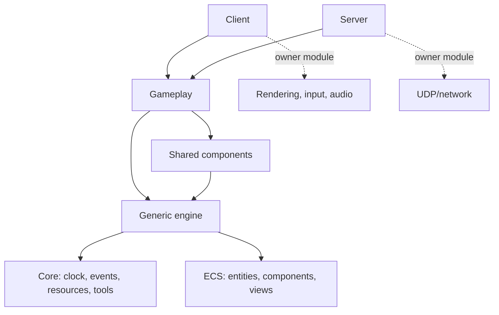

# R-Type

A networked R-Type-style shoot-'em-up built with a C++20 game engine. The project is organized
into independent engine, shared-component, gameplay, client, and server layers.

## Build requirements

- CMake 3.21 or newer
- A C++20 compiler
- Ninja on Linux (recommended)
- CPM.cmake downloads Catch2 when tests are enabled

The graphical client and network server are separate team modules. The engine can be configured
on its own from `engine/`.

## Build and test

Configure, build, and run the tests from the repository root:

```sh
cmake -S . -B build -G Ninja -DCMAKE_BUILD_TYPE=Debug -DRTYPE_BUILD_TESTS=ON
cmake --build build
ctest --test-dir build --output-on-failure
```

To run the headless Pong engine example:

```sh
cmake -S . -B build -G Ninja -DRTYPE_BUILD_EXAMPLES=ON -DRTYPE_BUILD_TESTS=OFF
cmake --build build
./build/bin/engine_pong
```

To build the engine independently, without configuring the full game:

```sh
cmake -S engine -B build-engine -G Ninja
cmake --build build-engine
```

## Architecture



The engine is generic: it has no dependency on R-Type, graphics, or networking. Gameplay systems
operate on registry views, and the authoritative server is responsible for game decisions.
See [docs/matraphlu-engine.md](docs/matraphlu-engine.md) and
[docs/architecture-study.md](docs/architecture-study.md).

The core module contains generic resource caching, a command/CVar console API, and a metrics
snapshot collector. Applications provide the resource loaders and platform-specific CPU/memory
sampling; the graphical metrics overlay is owned by the client module.

## Team

- Matteo (`matraphlu`): architecture and engine
- `theodsh`: graphical client
- `danbmg`: network and server
