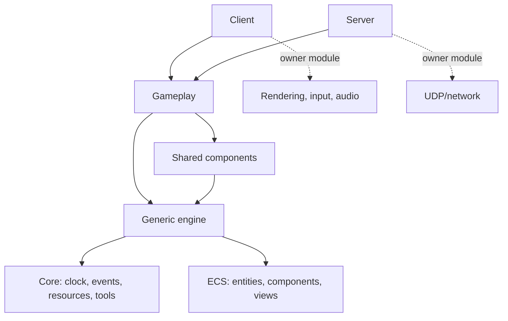

# R-Type: Save the Summoner's Cup

A networked R-Type-style shoot-'em-up for 1 to 4 players, built with a C++20 game engine. The
Summoner's Cup was stolen at the Worlds final: four T1 fighters (red, blue, green, yellow) chase
the Bydos across 10 levels and two bosses to bring it home, or fight endless waves for the high
score. The project is organized into independent engine, shared-component, gameplay, client, and
server layers; levels, enemies and bosses are JSON files that need no recompilation.

## Build requirements

- CMake 3.21 or newer and a C++20 compiler (GCC 11+, Clang 14+ or MSVC 2022)
- Ninja on Linux (recommended)
- Every third-party library is fetched and pinned by CPM.cmake in the root [CMakeLists.txt](CMakeLists.txt):
  Asio 1.36.0 (network), SFML 3.0.2 (client only), Catch2 3.8.1 (tests only).
  Nothing is taken from the system except compilers and low-level platform libraries.

SFML needs these low-level libraries on Linux:

```sh
# Fedora
sudo dnf install cmake ninja-build gcc-c++ libX11-devel libXrandr-devel libXcursor-devel \
  libXi-devel systemd-devel mesa-libGL-devel
# Ubuntu
sudo apt install cmake ninja-build g++ libx11-dev libxrandr-dev libxcursor-dev libxi-dev \
  libudev-dev libgl1-mesa-dev
```

## Build and test

From the repository root (dependencies are downloaded once into `CPM_SOURCE_CACHE`):

```sh
export CPM_SOURCE_CACHE=$HOME/.cache/CPM
cmake -S . -B build -G Ninja -DCMAKE_BUILD_TYPE=Release
cmake --build build -j
ctest --test-dir build --output-on-failure
```

`r-type_server` and `r-type_client` are written at the repository root. On Windows, drop
`-G Ninja` and add `--config Release` to the build and test commands.

| CMake option | Default | Effect |
| --- | --- | --- |
| `RTYPE_BUILD_TESTS` | `ON` | Builds the Catch2 unit tests |
| `RTYPE_BUILD_CLIENT` | `ON` | Builds the graphical client; `OFF` builds the server without SFML |
| `RTYPE_BUILD_EXAMPLES` | `OFF` | Builds the headless Pong engine example |
| `RTYPE_WARNINGS_AS_ERRORS` | `OFF` | Turns compiler warnings into errors (used by the CI) |

To run the headless Pong engine example:

```sh
cmake -S . -B build -G Ninja -DRTYPE_BUILD_EXAMPLES=ON
cmake --build build
./build/bin/engine_pong
```

To build the engine independently, without configuring the full game:

```sh
cmake -S engine -B build-engine -G Ninja
cmake --build build-engine
```

## Usage

The short version, command by command, is in [docs/demo.md](docs/demo.md).

Run both from the repository root (they find `assets/` there, or beside the executables):

```sh
./r-type_server -p 4242                      # authoritative game server (UDP)
./r-type_client -h 127.0.0.1 -p 4242         # graphical client: the menu opens
```

In the menu, choose the game mode (story or endless) and the difficulty, then JOIN THE GAME:
the first player of an empty server picks the game, the others join it. The menu also holds the
controls (any key can be bound to any action) and the accessibility options.

| Server option | Effect |
| --- | --- |
| `-p port` | UDP port (default 4242) |
| `--level N` | every game starts at level N (try `--level 5` or `--level 10` for the bosses) |
| `--content dir` | levels, enemies and bosses (default `assets/levels`) |
| `--check-content` | validates the content files, prints a summary and exits |

| Client option | Effect |
| --- | --- |
| `-h host`, `-p port` | server address (default 127.0.0.1:4242) |
| `--mode story\|endless`, `--difficulty easy\|normal\|hard` | preselect the menu |
| `--join` | skip the menu and join at once |
| `--assets dir`, `--mute` | asset directory, start silent |

In game: the bound keys move and fire (arrows and Space by default), F2 toggles auto-fire,
M mutes, + and − change the volume, F1 enlarges the text, Escape goes back to the menu.

Headless players, to test the server or to fill a game for a demo:

```sh
./build/bin/r-type_bot -p 4242 -n 3 -d 120 -b smart   # 3 bots that aim, dodge and catch the Cup
```

## Game design

| | |
| --- | --- |
| Modes | **Story**: 10 levels, a boss at levels 5 and 10, catch the Summoner's Cup to win. **Endless**: generated rounds, harder each time |
| Difficulty | easy (5 lives), normal (3), hard (2); scales enemy health, fire and speed |
| Enemies | drones, heavy drones, sine-wave wavers, zigzags, homing chargers, turrets, in formations |
| Bosses | The Gatekeeper and The Cup Thief: original designs with health-based phases (aimed volleys, fans, rings, walls, summons) |
| Power-ups | extra life, heal, rapid fire, double, spread and heavy weapons, shield |
| Presentation | T1 ships in 4 colours, tilt animation, themed parallax backgrounds, explosions, screen shake, title cards, victory screen |
| Sound | menu, stage and boss music, victory fanfare, 10 sound effects, optional captions |

See [the game design page](docs/game-design.md), and [the content guide](docs/content-guide.md)
to add a level, an enemy or a boss without writing C++. The network protocol (version 3) is
specified in [docs/protocol/rfc.md](docs/protocol/rfc.md); the server and network layer are
described in [docs/network.md](docs/network.md).

## Architecture



The engine is generic: it has no dependency on R-Type, graphics, or networking. Gameplay systems
operate on registry views, and the authoritative server is responsible for game decisions.
See [docs/matraphlu-engine.md](docs/matraphlu-engine.md) and
[docs/architecture-study.md](docs/architecture-study.md).

The core module contains generic resource caching, a command/CVar console API, and a metrics
snapshot collector. Applications provide the resource loaders and platform-specific CPU/memory
sampling; the graphical metrics overlay is owned by the client module.

## Team

- Matteo (`matraphlu`): architecture and engine
- `theodsh`: graphical client
- `danbmg`: network and server

## License

The source code is released under the [MIT License](LICENSE).

Third-party components and assets are not covered by it and keep their own licenses:

| Component | License |
| --- | --- |
| Asio | Boost Software License 1.0 |
| SFML | zlib/png license |
| Catch2 | Boost Software License 1.0 |
| CPM.cmake | MIT |
| DejaVu Sans font | DejaVu fonts license, see [assets/DejaVu-LICENSE.txt](assets/DejaVu-LICENSE.txt) |
| R-Type sprite sheets | original game artwork supplied for the project, no license granted, see [assets/README.md](assets/README.md) |
| T1 and Worlds logos | trademarks of T1 and Riot Games, non-commercial use only, see [assets/README.md](assets/README.md) |
| Generated sprites, music and sound effects | made for this project by `assets/tools/`, MIT |
