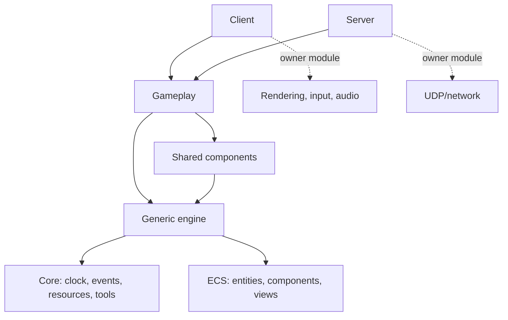

# R-Type

A networked R-Type-style shoot-'em-up built with a C++20 game engine. The project is organized
into independent engine, shared-component, gameplay, client, and server layers.

## Build requirements

- CMake 3.21 or newer and a C++20 compiler (GCC 11+, Clang 14+ or MSVC 2022)
- Ninja on Linux (recommended)
- Every third-party library is fetched and pinned by CPM.cmake in the root [CMakeLists.txt](CMakeLists.txt):
  Asio 1.36.0 (network), SFML 3.0.2 (client only), Catch2 3.8.1 (tests only).
  Nothing is taken from the system except compilers and low-level platform libraries.

SFML needs these low-level libraries on Linux:

```sh
# Fedora
sudo dnf install cmake ninja-build gcc-c++ libX11-devel libXrandr-devel libXcursor-devel \
  libXi-devel systemd-devel mesa-libGL-devel
# Ubuntu
sudo apt install cmake ninja-build g++ libx11-dev libxrandr-dev libxcursor-dev libxi-dev \
  libudev-dev libgl1-mesa-dev
```

## Build and test

From the repository root (dependencies are downloaded once into `CPM_SOURCE_CACHE`):

```sh
export CPM_SOURCE_CACHE=$HOME/.cache/CPM
cmake -S . -B build -G Ninja -DCMAKE_BUILD_TYPE=Release
cmake --build build -j
ctest --test-dir build --output-on-failure
```

`r-type_server` and `r-type_client` are written at the repository root. On Windows, drop
`-G Ninja` and add `--config Release` to the build and test commands.

| CMake option | Default | Effect |
| --- | --- | --- |
| `RTYPE_BUILD_TESTS` | `ON` | Builds the Catch2 unit tests |
| `RTYPE_BUILD_CLIENT` | `ON` | Builds the graphical client; `OFF` builds the server without SFML |
| `RTYPE_BUILD_EXAMPLES` | `OFF` | Builds the headless Pong engine example |
| `RTYPE_WARNINGS_AS_ERRORS` | `OFF` | Turns compiler warnings into errors (used by the CI) |

To run the headless Pong engine example:

```sh
cmake -S . -B build -G Ninja -DRTYPE_BUILD_EXAMPLES=ON
cmake --build build
./build/bin/engine_pong
```

To build the engine independently, without configuring the full game:

```sh
cmake -S engine -B build-engine -G Ninja
cmake --build build-engine
```

## Usage

```sh
./r-type_server -p 4242                      # authoritative game server (UDP)
./r-type_client -h 127.0.0.1 -p 4242         # graphical client
./build/bin/r-type_bot -p 4242 -n 4 -d 30    # 4 headless test players for 30 seconds
```

The network protocol is specified in [docs/protocol/rfc.md](docs/protocol/rfc.md); the server
and network layer are described in [docs/network.md](docs/network.md).

## Architecture



The engine is generic: it has no dependency on R-Type, graphics, or networking. Gameplay systems
operate on registry views, and the authoritative server is responsible for game decisions.
See [docs/matraphlu-engine.md](docs/matraphlu-engine.md) and
[docs/architecture-study.md](docs/architecture-study.md).

The core module contains generic resource caching, a command/CVar console API, and a metrics
snapshot collector. Applications provide the resource loaders and platform-specific CPU/memory
sampling; the graphical metrics overlay is owned by the client module.

## Team

- Matteo (`matraphlu`): architecture and engine
- `theodsh`: graphical client
- `danbmg`: network and server
