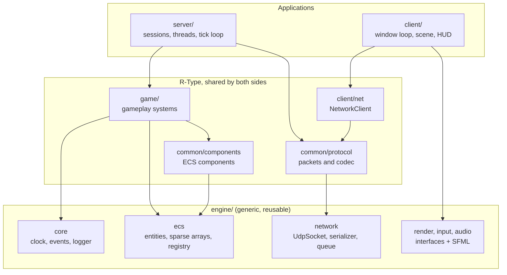
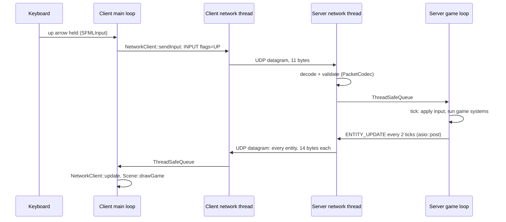
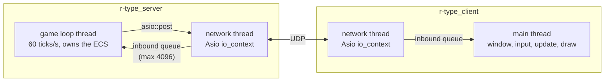

# Architecture overview

This page explains how the whole program fits together: the two executables, the layers, who
decides what, and what happens between a key press and the picture on screen. Each module then
has its own page with the details.

## Two programs, one engine

| | `r-type_server` | `r-type_client` |
| --- | --- | --- |
| Role | runs the game: the only authority on positions, hits, score and lives | shows the game and sends the player's keys |
| Threads | network thread + game loop thread | main thread (window, input, drawing) + network thread |
| Links | engine, game, protocol | engine, protocol, client network library, SFML |
| Never links | SFML or any window code | `game/`: it cannot run gameplay rules, even by mistake |
| Started with | `./r-type_server -p 4242` | `./r-type_client -h <server> -p 4242` |

Both are built from the same engine: an ECS, a fixed-step clock, a logger, a UDP socket and a
binary serializer that know nothing about R-Type.

## Layers

**Dependencies only go down.** The engine never includes `game/`, `common/`, `client/` or
`server/`, so it can be taken out and reused for another game (the
[Pong tutorial](pong-tutorial.md) does exactly that). The rule is enforced by the build, not by
discipline: each directory is a CMake target that links only the targets below it. Asio is
linked *privately* to `engine/network`, so no other module can include it; SFML is only linked by
`engine/render`, `input` and `audio`, which the server never links.

| Directory | What it holds | Owner | Details |
| --- | --- | --- | --- |
| `engine/core` | fixed timestep, event bus, logger, scheduler, resource cache, console, metrics | matraphlu | [Engine and gameplay](matraphlu-engine.md) |
| `engine/ecs` | `Entity`, `SparseArray`, `Registry` | matraphlu | [Engine and gameplay](matraphlu-engine.md) |
| `engine/network` | `UdpSocket` over Asio, `BinaryWriter` / `BinaryReader`, `ThreadSafeQueue` | danbmg | [Network and server](network.md) |
| `engine/render`, `input`, `audio` | `IRenderer`, `IInput`, `IAudio` and their SFML implementations | theodsh | [Game design](game-design.md#how-it-is-built) |
| `common/components` | plain data: `Position`, `Velocity`, `Hitbox`, `Health`, `Player`, `Enemy`, `Projectile`… | matraphlu | [Engine and gameplay](matraphlu-engine.md) |
| `common/protocol` | `Packets.hpp` (the wire contract) and `PacketCodec` | danbmg | [Protocol RFC](protocol/rfc.md) |
| `game/` | the gameplay systems: waves, movement, collisions, damage, score | matraphlu | [Engine and gameplay](matraphlu-engine.md) |
| `server/` | `Server`, `SessionManager`, `GameWorld`, `r-type_server` | danbmg | [Network and server](network.md) |
| `client/net` | `NetworkClient` and the `r-type_bot` test client | danbmg | [Network and server](network.md#using-networkclient-in-the-graphical-client) |
| `client/` | application loop, `Scene`, command line options | theodsh | [Game design](game-design.md#how-it-is-built) |

## Who decides what

The server is the **authority**: it is the only program that runs gameplay rules. A client sends
which keys are held, never a position, a hit or a score. A modified client can therefore only
press keys; it cannot teleport, survive a hit or give itself points.

| Decision | Made by | Where in the code |
| --- | --- | --- |
| a ship moves, a missile is fired (with a 0.25 s cooldown) | server | `GameWorld::applyInput`, `game::updateMovement` |
| a Bydos appears, shoots | server | `game::registerEnemySystems` |
| a missile hits, a ship loses health or a life, the score goes up | server | `game::resolveProjectileCollisions`, `handlePlayerDeaths` |
| a player joins, is refused, times out | server | `Server::handleConnect`, `SessionManager` |
| which sprite, colour and sound to use | client | `Scene::drawGame`, `Scene::handleEvents` |
| where to draw an entity | client, from the last server position | `Scene::drawGame` |

## One key press, from keyboard to screen

What happens when player 1 holds the up arrow:

1. **Read the keys.** Each frame, `client/main.cpp` asks `IInput` which keys are down, using the
   layout the player picked (arrows, WASD or ZQSD). A window without focus reads no key.
2. **Send them.** `NetworkClient::sendInput` packs the five keys into one byte of flags and sends
   an INPUT packet when they change, and at least every 33 ms while they don't, so a lost
   datagram is replaced quickly.
3. **Validate on arrival.** The server's network thread receives the datagram in
   `Server::onDatagram`. `protocol::decode` checks size, magic number, version, type, declared
   length and every value. Anything wrong is counted and dropped right there.
4. **Hand over to the game loop.** A valid packet goes into a bounded `ThreadSafeQueue`. The
   network thread never touches the game state.
5. **Simulate.** At its next tick (60 per second), the game loop drains the queue, stores the
   new flags in the player's session, turns them into a velocity (`GameWorld::applyInput`), then
   runs every gameplay system in a fixed order (`GameWorld::step`).
6. **Publish.** Every second tick (30 times per second) the server sends ENTITY_UPDATE with the
   position of every entity, and PLAYER_STATUS with lives, health and score. New and removed
   entities are sent as soon as they happen (ENTITY_SPAWN, ENTITY_DESTROY), for sounds and
   explosions.
7. **Apply on the client.** The client's network thread validates the datagram the same way and
   queues it. On the next frame, `NetworkClient::update` applies it to its copy of the world;
   older snapshots are ignored thanks to the tick number they carry.
8. **Draw.** `Scene::drawGame` scales each entity from server units (800 × 600) to the window and
   draws its sprite; the HUD shows lives, health and score.

**Worst-case delay, from the constants:** up to 17 ms before the next server tick, up to 33 ms
before the next snapshot, up to 17 ms before the next client frame: about 67 ms plus the network
transit time. Smoothing positions between snapshots (interpolation) and predicting the local ship
are planned.

## Threads and shared data

The rule on both sides: **the game state belongs to one thread.** The only object two threads
share is a `ThreadSafeQueue` (a mutex around a bounded `std::deque`), plus a few atomic
counters. The game loop never waits for the network: it takes whatever the queue holds and goes
on, even with no client connected. No exception may leave a thread: each one catches around its
handler or its tick, logs, and continues.

## Time

- **Server:** `engine::core::FixedTimestep` adds up real elapsed time from a monotonic clock and
  runs one tick per 1/60 s accumulated. After a stall it catches up at most 5 ticks, then drops
  the backlog rather than spiralling. The simulation never depends on CPU speed.
- **Client:** everything moving on screen uses elapsed seconds (`distance = speed × seconds`),
  never a frame counter. A test checks that the starfield ends at the same place at 30 and at
  144 frames per second.

## Inside the server: the ECS

The world is an **ECS** (entity–component–system): an entity is just an id, components are plain
data stored per type in sparse arrays, and systems are functions that walk the entities having a
given set of components.

| ECS concept | In R-Type |
| --- | --- |
| entity | a ship, a Bydos or a missile: a number, never reused |
| component | `Position`, `Velocity`, `Hitbox`, `Health`, `Player`, `Enemy`, `Projectile` |
| system | `enemy-spawner`, `enemy-fire`, `movement`, `player-bounds`, `offscreen-cleanup`, `projectile-collisions`, `ship-collisions`, `player-deaths`, `dead-entity-cleanup`, run in this order every tick |

`GameWorld` is the only place where ECS data is translated into protocol terms (`EntityKind`,
player ids). It compares the world with the previous tick to find what appeared and disappeared,
so the gameplay code never hears about the network. Details and the reasons for sparse arrays are
in [Engine and gameplay](matraphlu-engine.md) and the
[engine study](architecture-study.md).

## When things go wrong

| Situation | What happens |
| --- | --- |
| a malformed, oversized or random datagram | dropped and counted, never read past its end; the server logs new drops every 5 s |
| a client floods the server | at most 8 packets per client per tick are processed; the queue is bounded |
| a client crashes or loses its connection | after 3 s of silence its ship is removed and the others receive PLAYER_LEFT |
| the server stops | each client shows "connection lost" after 3 s and offers to reconnect |
| a fifth player tries to join | REJECT "server full", shown on screen |
| a DESTROY packet is lost | the client drops entities absent from snapshots for 500 ms |

The full table, with the tests that prove each line, is in
[Network and server](network.md#robustness).

## Code tour

To read the code in the order the data flows, about an hour in total:

1. [`server/main.cpp`][server-main]: parses `-p`, starts the server, waits for Ctrl+C.
2. [`server/Server.cpp`][server-cpp]: `onDatagram` (network thread), `gameLoop` and `tick` (game
   loop thread), `handlePacket`, `broadcastSnapshot`.
3. [`server/GameWorld.cpp`][gameworld]: the bridge between sessions, the ECS and the protocol.
4. [`game/GameSystems.cpp`][gamesystems]: the gameplay rules.
5. [`common/protocol/Packets.hpp`][packets] and [`PacketCodec.cpp`][codec]: the wire format and
   its validation.
6. [`engine/network/UdpSocket.cpp`][udpsocket]: the only file that uses Asio.
7. [`client/main.cpp`][client-main]: the client loop, one frame at a time.
8. [`client/net/NetworkClient.cpp`][networkclient]: connection, heartbeat, the client's copy of the
   world.
9. [`client/Scene.cpp`][scene]: from entities to sprites, sounds and HUD.
10. [`engine/ecs/Registry.hpp`][registry]: how entities and components are stored.

[server-main]: https://github.com/EpitechPGE3-2026/G-ING-500-NCE-5-1-rtype-2/blob/main/server/main.cpp
[server-cpp]: https://github.com/EpitechPGE3-2026/G-ING-500-NCE-5-1-rtype-2/blob/main/server/Server.cpp
[gameworld]: https://github.com/EpitechPGE3-2026/G-ING-500-NCE-5-1-rtype-2/blob/main/server/GameWorld.cpp
[gamesystems]: https://github.com/EpitechPGE3-2026/G-ING-500-NCE-5-1-rtype-2/blob/main/game/GameSystems.cpp
[packets]: https://github.com/EpitechPGE3-2026/G-ING-500-NCE-5-1-rtype-2/blob/main/common/protocol/Packets.hpp
[codec]: https://github.com/EpitechPGE3-2026/G-ING-500-NCE-5-1-rtype-2/blob/main/common/protocol/PacketCodec.cpp
[udpsocket]: https://github.com/EpitechPGE3-2026/G-ING-500-NCE-5-1-rtype-2/blob/main/engine/network/UdpSocket.cpp
[client-main]: https://github.com/EpitechPGE3-2026/G-ING-500-NCE-5-1-rtype-2/blob/main/client/main.cpp
[networkclient]: https://github.com/EpitechPGE3-2026/G-ING-500-NCE-5-1-rtype-2/blob/main/client/net/NetworkClient.cpp
[scene]: https://github.com/EpitechPGE3-2026/G-ING-500-NCE-5-1-rtype-2/blob/main/client/Scene.cpp
[registry]: https://github.com/EpitechPGE3-2026/G-ING-500-NCE-5-1-rtype-2/blob/main/engine/ecs/Registry.hpp
