# Game design: Save the Summoner's Cup

This page describes the game the players see: the two game modes, the story, the enemies, the bosses, the power-ups and the presentation. To add or
change content, read the [content guide](content-guide.md): no C++ is needed.

## The pitch

> Worlds 2026, Grand Final. The Summoner's Cup shines on stage... then the lights go out. When
> they come back, the Cup is gone: a Bydos raiding fleet is fleeing into deep space with it.
> T1 scrambles its four fighters. Give chase!

Up to four players fly R-Type ships marked with the T1 emblem, one colour each: **red** (P1),
**blue** (P2), **green** (P3) and **yellow** (P4). Every ship also carries its `P1`–`P4` label,
so players never depend on colour alone.

## Game modes

The first player to join an empty server chooses the mode and the difficulty in the menu.
Players who join later play the game in progress.

| Mode | What happens | How it ends |
| --- | --- | --- |
| **Story** | 10 hand-made levels, a boss at level 5 and at level 10 | The final boss drops the Summoner's Cup; catching it wins. Victory screen, then a new story |
| **Endless** | Generated levels forever, harder each round; a boss closes every level, a named one every 3 levels | Never: play for the high score |

In both modes, when every player is out of lives the game is over: a 6-second countdown, then
the game restarts with everyone back in. A player out of lives while the team fights on can
press Enter to continue with a fresh ship (and a reset score), as in an arcade.

### Difficulty

| | Easy | Normal | Hard |
| --- | --- | --- | --- |
| Lives per player | 5 | 3 | 2 |
| Enemy health | × 0.6 | × 1 | × 1.5 |
| Enemy fire rate | × 0.55 | × 1 | × 1.4 |
| Enemy shot speed | × 0.8 | × 1 | × 1.2 |
| Enemy speed | × 0.9 | × 1 | × 1.1 |
| Power-up drops | × 1.5 | × 1 | × 0.8 |

Easy is also an accessibility setting: slower shots and more lives give more time to react.

## The story

| Level | Title | Theme | What is new |
| --- | --- | --- | --- |
| 1 | Worlds Final: The Heist | blue | drones in formations, first wavers |
| 2 | Play-In: Asteroid Lanes | amber | sine-wave wavers, heavy drones |
| 3 | Swiss Stage: Round One | green | chargers: kamikazes that dive at you |
| 4 | Swiss Stage: Elimination Match | red | turrets firing volleys, zigzags |
| 5 | **Quarterfinal: The Gatekeeper** | purple | **boss 1** |
| 6 | Semifinal: Nebula Drift | amber | dense wave patterns |
| 7 | Semifinal: Turret Fortress | red | turret walls |
| 8 | Finals Approach: The Rift | green | everything at once |
| 9 | Grand Final: Game Five | blue | the hardest regular waves |
| 10 | **The Summoner's Cup** | purple | **final boss**, then catch the Cup |

Each level opens on a title card with its story text, then runs its waves in order. Between
waves there is a short breather; after the last wave, "stage clear" and the next level.

## Enemies

Each enemy type is a few lines of `assets/levels/enemies.json`; its look comes from the supplied
sprite sheets.

| Type | Looks like | Movement | Attack | Health |
| --- | --- | --- | --- | --- |
| drone | Bydos fighter | straight | a shot now and then | 1 |
| heavy-drone | Bydos fighter | straight, slower | pairs of shots | 3 |
| waver | organic flyer | sine wave | rare shots | 2 |
| zigzag | organic flyer | bounces up and down | rare shots | 2 |
| charger | spinning spore | steers at the closest ship | none: rams | 1 |
| turret | gun platform | drifts with the scenery | volleys of 3 aimed shots | 5 |

Waves place enemies in **formations**: random heights, a horizontal line, a V, or stairs from
top to bottom.

## Bosses

Bosses are original designs drawn for this game. Each has **phases**: when its health drops
below a threshold it changes its attacks and moves faster. The attacks are aimed volleys, fans
of shots, rings in every direction, walls with a gap to fly through, and summoned minions.

| Boss | Level | Health (normal) | Phase 1 | Phase 2 (60 %) | Phase 3 (30 %) |
| --- | --- | --- | --- | --- | --- |
| The Gatekeeper | 5 | 150 | aimed volleys, fans | fans, summons chargers | rings, aimed, walls |
| The Cup Thief | 10 | 280 | fans, aimed, walls | rings, summons wavers | everything, faster |

The Cup Thief holds the Summoner's Cup in its claws. When it dies, the Cup floats where it fell:
the story is won when a player flies into it.

A boss arrival triggers a "WARNING" banner, an alarm and the boss music; a health bar shows its
remaining health and flashes on every hit. Its death is a chain of explosions with a screen
shake (which can be turned off).

## Power-ups

Enemies may drop a capsule when they die (bosses always do). Each capsule shows a **letter**, so
it can be told apart without colour.

| Capsule | Letter | Effect |
| --- | --- | --- |
| Extra life | 1 | +1 life (up to 9) |
| Heal | + | health back to full |
| Rapid fire | R | shoots 2.5 times faster for 8 s |
| Double | D | two parallel shots |
| Spread | S | three shots in a fan |
| Heavy | H | slower, 3 damage per shot |
| Shield | O | absorbs the next hit (12 s at most) |
| The Cup | (trophy) | wins the story, +10000 points |

Weapons last until the ship loses a life. A ship that loses a life is invulnerable for 2
seconds (it blinks), so the shots already on their way cannot take a second life at once.

## Presentation

| Element | What the player sees and hears |
| --- | --- |
| Background | three layers of stars, drifting planets and nebula bands, coloured by each level's theme |
| Ships | tilt frames when climbing or diving, engine flame, red flash when hit, shield bubble |
| Enemies and bosses | animated sprites, bosses flash red when hit |
| Explosions | animated blasts, a chain of blasts and a screen shake for bosses |
| HUD | per player: T1 emblem in the player's colour, lives, health pips, score, weapon, shield, rapid-fire bar |
| Footer | mode, difficulty, level, wave, level title, controls |
| Screens | menu, level title card, stage clear, warning, game over, victory with the Cup and confetti |
| Music | menu, stage and boss loops; a victory fanfare |
| Sound effects | shots, explosions, boss explosion, power-up, hit, shield down, boss alarm, stage clear, menu |
| Captions | important sounds are also written on screen (optional) |

Every new sound and sprite is generated by a script in `assets/tools/`, except the
supplied R-Type sheets and the T1 and Worlds logos (see [assets/README.md](https://github.com/EpitechPGE3-2026/G-ING-500-NCE-5-1-rtype-2/blob/main/assets/README.md)).

## How it is built

The content is data, the rules are on the server, the presentation is on the client.

```mermaid
flowchart LR
    Files["assets/levels/*.json"] -->|loadContent, validated at start| Content["game::GameContent"]
    Content --> Director["game::LevelDirector<br/>waves, formations, phases"]
    Director --> ECS["ECS registry<br/>EnemyBehavior, BossBehavior, Appearance"]
    ECS --> Systems["behaviour, movement, collision,<br/>pickup and death systems"]
    Systems --> World["server::GameWorld<br/>lobby, game over, victory"]
    World -->|GAME_STATUS, LEVEL_INFO,<br/>entities| Client["client::Scene<br/>sprites, HUD, music"]
```

| Piece | File | Role |
| --- | --- | --- |
| Content loader | `game/Content.cpp` | reads and validates the JSON files, reports mistakes by file and field |
| Level catalog | `game/Level.cpp` | story levels from files, endless levels generated |
| Level director | `game/LevelDirector.cpp` | intro, waves, formations, boss, Cup, level changes |
| Behaviours | `game/EnemyBehaviors.cpp` | movement patterns, volleys, boss phases and attacks |
| Equipment | `game/EquipmentSystems.cpp` | weapons, power-ups, shield, respawn invulnerability |
| Game state | `server/GameWorld.cpp` | lobby, mode and difficulty, game over, victory, restart |
| Presentation | `client/Scene.cpp`, `client/Menu.cpp` | everything drawn and heard |

Components stay plain data: an enemy stores its movement parameters (`EnemyBehavior`), a boss
stores the index of its type and its current phase (`BossBehavior`), and the look of an entity
is a `Visual` value (`Appearance`) that the server translates into a protocol entity kind.
