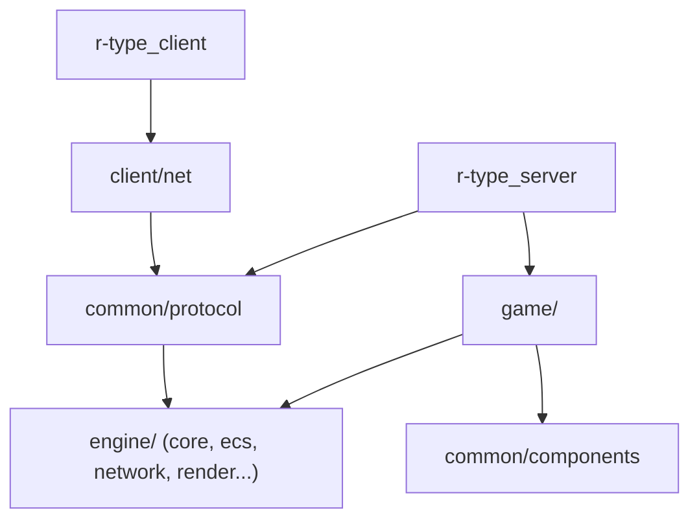

# R-Type

A networked remake of the classic shoot'em up R-Type, built on our own C++20 game engine.
Up to four players fight the Bydos together; an authoritative server runs the game and every
player uses a graphical client.

## Quick start

```sh
export CPM_SOURCE_CACHE=$HOME/.cache/CPM
cmake -S . -B build -G Ninja -DCMAKE_BUILD_TYPE=Release
cmake --build build -j
./r-type_server -p 4242
./r-type_client -h 127.0.0.1 -p 4242
```

Build requirements and options are in the repository [README](https://github.com/EpitechPGE3-2026/G-ING-500-NCE-5-1-rtype-2#readme).

## Documentation

| Page | Contents |
| --- | --- |
| [Engine and gameplay](matraphlu-engine.md) | the ECS, the core tools, the gameplay systems and their order |
| [Network and server](network.md) | threads, modules, using `NetworkClient`, adding a packet, robustness |
| [Protocol RFC](protocol/rfc.md) | the wire format, complete enough to write a new client |
| [Headless Pong](pong-tutorial.md) | a second game built on the engine alone |
| [Architecture and tooling study](architecture-study.md) | ECS data layout, build system, package manager |
| [Networking, storage and security study](network-study.md) | network library, protocol design, concurrency, storage, security |

## Architecture at a glance



Dependencies only go down: the engine knows nothing about R-Type, and the server never links the
graphics library.

## Team

| Member | Area |
| --- | --- |
| matraphlu | architecture, engine, gameplay systems |
| theodsh | graphical client, rendering, audio, input, accessibility |
| danbmg | network, server, protocol, CI |
