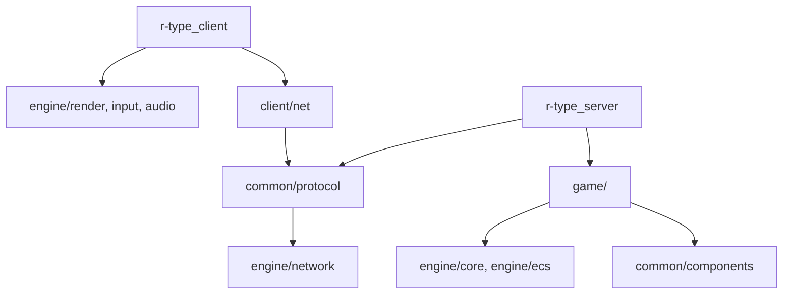

# R-Type

A networked remake of the classic shoot'em up R-Type, built on our own C++20 game engine.
Up to four players fight the Bydos together. An authoritative server runs the game; each player
runs a graphical client that sends key presses and draws what the server reports.

## What works today

- `r-type_server`: multithreaded UDP server, up to 4 players, fixed 60 ticks per second.
- `r-type_client`: SFML client with a scrolling starfield, four distinguishable ships, Bydos,
  missiles both ways, sounds, lives, health and score.
- Random Bydos waves, enemy fire, collisions, damage, death and score, all decided by the server.
- A crashed or silent client is dropped after 3 seconds; the others keep playing.
- 76 automated tests: engine, gameplay, protocol parsing (including malformed and random
  datagrams), server and client integration.

## Where to start

| You want to… | Read |
| --- | --- |
| build and play | [Getting started](getting-started.md) |
| understand how the whole program works | [Architecture overview](architecture.md), then the page of each module |
| write your own client for our server | the [Protocol RFC](protocol/rfc.md): it is enough on its own |
| know why we chose each technology | [Stack overview](stack.md), then the three detailed studies |
| check what we do for players with disabilities | [Accessibility](accessibility.md) |
| make a game with the engine alone | the [Headless Pong tutorial](pong-tutorial.md) |
| look up a term (tick, snapshot, ECS…) | the [Glossary](glossary.md) |

## Architecture at a glance

Dependencies only go down: the engine knows nothing about R-Type, the server never links the
graphics library, and the client never runs gameplay rules. The
[Architecture overview](architecture.md) follows one key press through every layer.

## All pages

| Section | Page | Contents |
| --- | --- | --- |
| How it works | [Architecture overview](architecture.md) | layers, modules, threads, one key press from keyboard to screen, code tour |
| | [Engine and gameplay](matraphlu-engine.md) | ECS, core tools, gameplay systems and their order |
| | [Network and server](network.md) | server threads, one tick, `NetworkClient`, adding a packet, robustness |
| | [Graphical client](theodsh-client.md) | client loop, rendering, controls, one frame explained |
| Protocol | [Protocol RFC](protocol/rfc.md) | the wire format, every packet, exchanges, validation rules |
| Technical choices | [Stack overview](stack.md) | every technology, the alternatives, why we chose it |
| | [Engine, build and dependencies](architecture-study.md) | ECS data layout, CMake, CPM |
| | [Graphics and audio](client-study.md) | SFML against SDL and raylib |
| | [Networking, storage and security](network-study.md) | Asio, UDP, serialization, synchronisation, threads, storage, security |
| Accessibility | [Accessibility](accessibility.md) | motor, visual, hearing and cognitive needs, in the game and in this site |
| Tutorials | [Headless Pong](pong-tutorial.md) | a second game built on the engine alone |

## Team

| Member | GitHub | Area |
| --- | --- | --- |
| Matteo | [@matraphlu](https://github.com/matraphlu) | architecture, engine, gameplay systems |
| Théo | [@theodsh](https://github.com/theodsh) | graphical client, rendering, audio, input, accessibility |
| Dan | [@danbmg](https://github.com/danbmg) | network, server, protocol, CI, documentation site |
