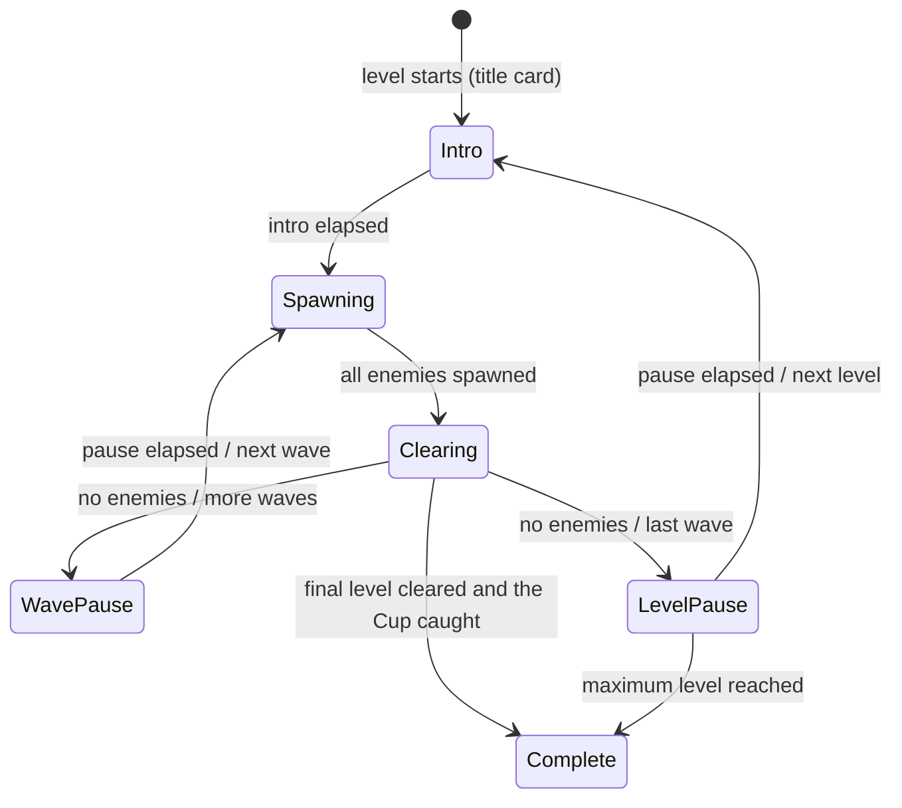

# Server level architecture

The authoritative server owns level progression. No rendering, textures or UI are part of the
level definitions or the director. Levels, enemies and bosses come from the JSON files of
`assets/levels/` (see the [content guide](content-guide.md)); code can also define them.

| Type | Responsibility |
| --- | --- |
| `game::WaveDefinition` | Enemy type or boss, count, spawn interval, formation, speed multiplier, pickup drop chance (and the stats of a generic Bydos) |
| `game::LevelDefinition` | Level number, ordered waves, pauses, title, story text, background theme, intro duration |
| `game::LevelCatalog` | Explicit definitions, an optional final level (the story), and generated levels for every other number (endless) |
| `game::GameContent` | Enemy types, boss types, the story catalog and the endless catalog, loaded by `game::loadContent` |
| `game::LevelDirector` | Runtime state: intro, spawning, formations, enemy behaviours, bosses, the Cup, automatic progression |
| `game::LevelProgress` | Current level, wave and wave count, spawn count, enemies remaining, boss health, phase and countdown |
| `server::GameWorld` | Owns the director and the ECS; adds the lobby, game modes, difficulty, game over, victory and restarts |



A level whose `introSeconds` is 0 starts directly with `Spawning`. A normal enemy that escapes
counts as cleared. A boss stays on screen until killed. When the final boss of a finite
campaign drops the Summoner's Cup, the wave is not cleared until a player catches it.
Projectiles are removed when an encounter clears, so the following encounter starts without
stray shots. Players, health, lives and scores survive transitions.

## Story and endless

The story is a `LevelCatalog` with explicit levels and a final level (`setFinalLevel`): clearing
it completes the game (`LevelPhase::Complete`), which `GameWorld` turns into the victory screen.
Endless mode uses a catalog without a final level: `LevelCatalog::get(number)` generates any
level from its `LevelGenerator` (enemy pool, named bosses, waves per level). Difficulty grows
with the level number up to level 100 values: at most 50 enemies per wave and bounded speeds
and fire rates.

## Enemies and bosses

Each spawned enemy carries an `EnemyBehavior` (movement pattern, speed, amplitude, frequency,
fire rate, volley size) and an `Appearance` (its look). Each boss carries a `BossBehavior` (its
type index in `GameContent::bosses`, current phase and attack timer). The director runs
`updateEnemyBehaviors` and `updateBosses` (`game/EnemyBehaviors.cpp`) every tick, before the
movement and collision systems. Difficulty multipliers (`game::difficultySettings`) scale
health, fire rate, shot speed, speed and drops when enemies spawn.

## Define a level in code

```cpp
#include "server/GameWorld.hpp"

game::GameContent content;        // or game::loadContent("assets/levels")
game::LevelDefinition level;
level.number = 1;
level.title = "Test";
game::WaveDefinition wave;
wave.enemyCount = 8;              // a generic Bydos wave
wave.enemyHealth = 2;
wave.spawnIntervalSeconds = 0.8F;
level.waves.push_back(wave);
game::WaveDefinition boss;
boss.boss = true;
boss.enemyCount = 1;
boss.enemyHealth = 50;
level.waves.push_back(boss);
content.story.define(level);      // validates
content.story.setFinalLevel(1);
server::GameWorld world(60, 42, {}, content);
```

## Server API

- `ServerConfig::initialLevel` / `r-type_server --level N`: the level every game starts at.
- `ServerConfig::content` / `r-type_server --content DIR`: the content directory
  (`assets/levels` by default); `--check-content` validates it and exits.
- `GameWorld::requestGame(mode, difficulty)`: what the next game is, used when the first player
  joins an empty world.
- `GameWorld::gameStatus()` and `GameWorld::levelInfo()`: the GAME_STATUS and LEVEL_INFO
  packets of the protocol.
- `GameWorld::levelProgress()`, `levelDefinition()`, `loadLevel(N)`: inspect or jump.
