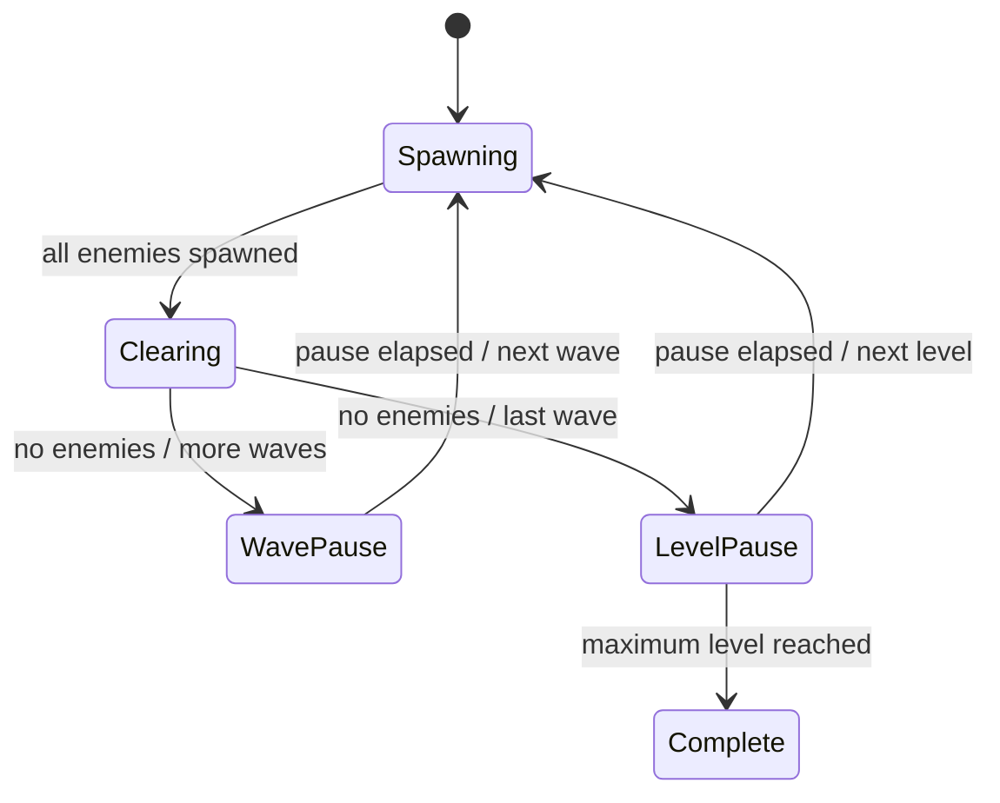

# Server level architecture

The authoritative server owns level progression. No rendering, textures or UI are part of
the level definitions or director.

| Type | Responsibility |
| --- | --- |
| `game::WaveDefinition` | Enemy count, spawn interval, health, speed, fire rate, projectile speed, boss flag, pickup drop chance |
| `game::LevelDefinition` | Level number, ordered waves, pauses between waves and levels |
| `game::LevelCatalog` | Explicit definitions and generated defaults for every positive level number |
| `game::LevelDirector` | Runtime state, spawning, enemy fire, boss movement and automatic progression |
| `game::LevelProgress` | Current level, local wave number/count, spawn count, enemies remaining, boss flag and phase |
| `server::GameWorld` | Owns the director and ECS; runs the director before movement, collisions and cleanup |

The default campaign has five waves per level. Waves 5, 10, 15 of the default campaign
are bosses (wave 5 of each successive level). Custom levels can have any nonempty list
of waves and place bosses explicitly. Difficulty grows with the level number up to level
100 values: at most 50 enemies per wave, 1020 boss HP, and bounded speeds and fire rates.
The level number continues increasing beyond 100. Level zero is invalid. The final
representable `uint32_t` level ends in `Complete` rather than wrapping.



A normal enemy that escapes counts as cleared. A boss stays on screen until killed.
Projectiles are removed when an encounter clears, so the following encounter starts without
stray shots. Players, health, lives and scores survive transitions. Progression follows world
ticks, including ticks with no players; it is not tied to any individual session.

## Define a custom level

```cpp
#include "server/GameWorld.hpp"

game::LevelCatalog catalog;
game::LevelDefinition level;
level.number = 2;
level.interWaveDelaySeconds = 2.0F;
level.nextLevelDelaySeconds = 4.0F;

game::WaveDefinition normal;
normal.enemyCount = 8;
normal.enemyHealth = 2;
normal.spawnIntervalSeconds = 0.8F;
level.waves.push_back(normal);

game::WaveDefinition boss;
boss.boss = true;
boss.enemyCount = 1;
boss.enemyHealth = 50;
level.waves.push_back(boss);

catalog.define(level); // validates; replaces any existing override for level 2
server::GameWorld world(60, 42, {}, catalog, 2);
```

`LevelCatalog::get(number)` returns an explicit override when available, otherwise a generated
level. Definitions are copied into the director; changing a separate catalog afterwards does
not mutate a running game. Add authored definitions at server world construction time. The
existing `registerEnemySystems` helper remains available for gameplay callers; the authoritative
server uses its own director directly.

## Server API

- `ServerConfig::initialLevel` / `r-type_server --level N`: select the starting level (default 1).
- `GameWorld::levelDefinition()`: read the current level's waves and settings.
- `GameWorld::levelProgress()`: read the director state from the game loop thread.
- `GameWorld::loadLevel(N)`: immediately reset to wave 1 of level N, clearing enemies and
  all projectiles and pickups while retaining player state and equipment. An invalid number leaves the world intact.
  Existing `collectChanges()` then reports entity removals through the usual network path.

The progress counters describe the director's most recent update, before that tick's collision
and cleanup systems. Kills and enemies leaving the screen are observed on the next tick.
The API is server-side; there is no new level HUD or level-progress packet. A client feature
can later serialize `LevelProgress` without moving campaign rules into the client.

Bosses use `Enemy::BOSS_PATTERN`, health, a larger hitbox, vertical movement and a higher
fire rate. They award 1000 points through the existing scoring system. Contact damages the
boss by one HP and pushes the player away. Protocol entity kind 5 identifies them; the client
currently uses its existing enemy sprite as a placeholder. Dedicated graphics belong to the
client implementation.
