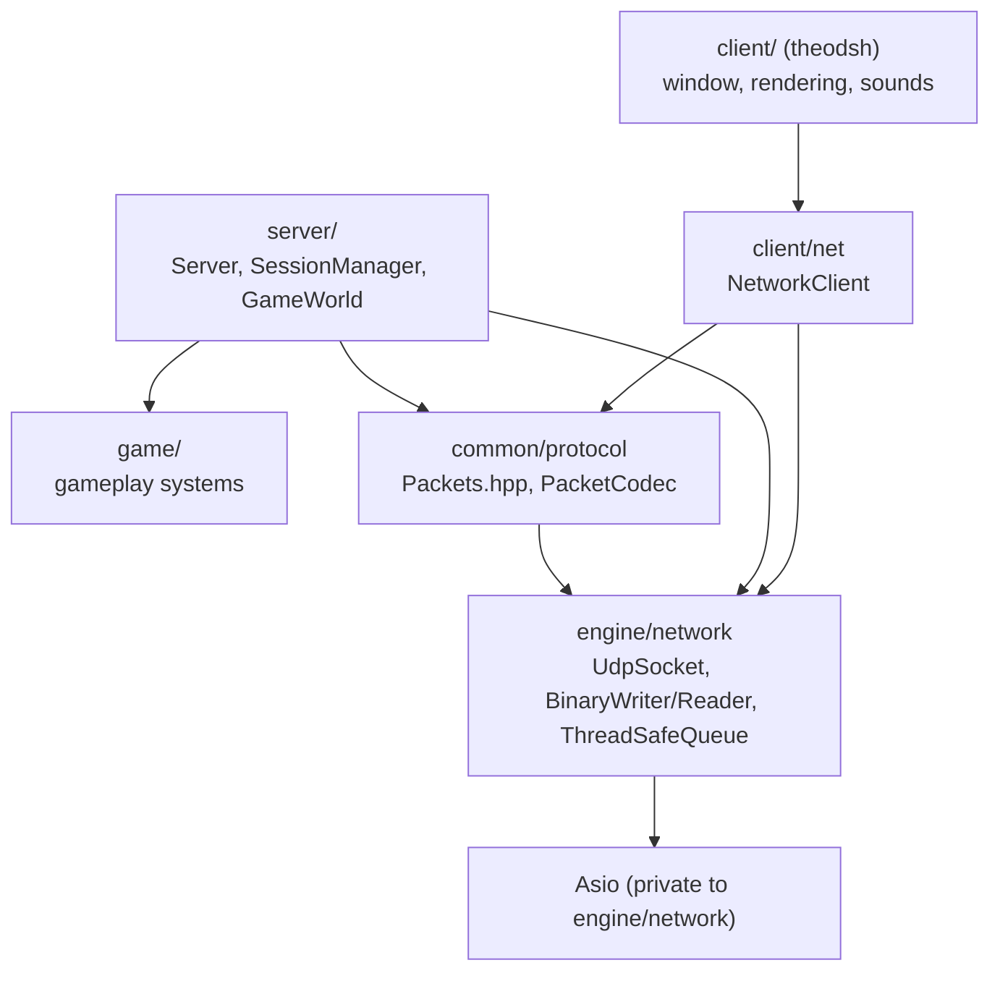
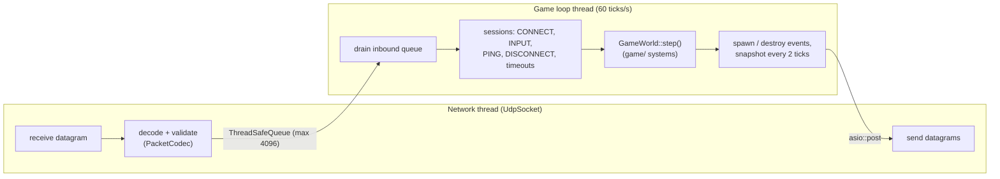

# Network and server

This page describes the network layer, the server and the client network library: how they are
split, how the threads talk to each other, and how to use or extend them. The wire format itself
is specified in the [protocol RFC](protocol/rfc.md).

## Layers



| Module | Knows about | Contents |
| --- | --- | --- |
| `engine/network` | nothing of R-Type | `UdpSocket` (UDP on its own thread), `Endpoint`, `BinaryWriter` / `BinaryReader` (big-endian, bounds-checked), `ThreadSafeQueue` (bounded) |
| `common/protocol` | the engine | `Packets.hpp` (the frozen contract) and `PacketCodec` (`encode` / `decode` with strict validation) |
| `server` | game, protocol, engine | the authoritative server and `r-type_server` |
| `client/net` | protocol, engine | `NetworkClient`, the only thing the graphical client needs, and the `r-type_bot` test client |

Asio is linked privately to `engine-network`: no other module includes it, and `UdpSocket.hpp`
exposes plain types only. The server does not link SFML; `client/net` does not link `game/`, so
the client cannot run gameplay rules even by mistake.

## Server threads



- The **network thread** runs Asio. It decodes and validates every datagram; invalid ones are
  counted and dropped there, so the game loop only sees well-formed client packets.
- The **game loop thread** runs on `engine::core::FixedTimestep`. It never waits for the network:
  it takes whatever the queue holds (`drain()`, one lock per tick) and goes on, even with no
  client at all. After a stall it catches up at most 5 ticks, then drops the backlog.
- Sending goes the other way through `asio::post`: the game loop never touches the socket, which
  only the network thread uses (an Asio socket must not be used by two threads at once).
- No exception escapes either thread: the network thread catches around its handler and around
  `io_context::run()`, the game loop catches around each tick.

### One tick

1. Drain the inbound queue: CONNECT creates a session and a ship (or answers REJECT), INPUT
   updates the session's input flags if its sequence is newer, PING answers PONG, DISCONNECT
   closes the session.
2. Remove sessions silent for 3 seconds and send PLAYER_LEFT `TimedOut` to the others.
3. Apply each session's input flags to its ship (movement, fire with a 0.25 s cooldown).
4. `GameWorld::step()`: the `game/` systems (enemy waves, movement, collisions, deaths, cleanup).
5. Compare the world with the previous tick: send ENTITY_SPAWN and ENTITY_DESTROY.
6. Every 2 ticks: ENTITY_UPDATE with every entity, PLAYER_STATUS and GAME_STATUS (mode,
   difficulty, phase, level, wave, boss health, countdown).
7. When a level starts, and every second: LEVEL_INFO (title, story, background theme).

The first CONNECT on an empty server carries the game mode and difficulty of the new game
(protocol version 3); later players join the game in progress. Inputs are applied by player id,
because ships are replaced when a game restarts after a game over or a victory.

`GameWorld` is the only place where ECS components are translated into protocol terms
(`EntityKind`, player ids): the gameplay code stays unaware of the network.

## Using NetworkClient in the graphical client

Link it from `client/CMakeLists.txt`:

```cmake
target_link_libraries(r-type_client PRIVATE rtype::client-net)
```

Then, in the client loop:

```cpp
#include "client/net/NetworkClient.hpp"

client::net::NetworkClient network;
network.connect(host, port); // from the command line (-h, -p); never blocks

while (window.isOpen()) {
  network.update(); // once per frame: applies what the server sent
  if (network.state() == client::net::ConnectionState::Rejected ||
      network.state() == client::net::ConnectionState::Failed) {
    showError(network.error()); // "the server is full", "connection lost..."
  }
  network.sendInput({up, down, left, right, fire});

  for (const auto& event : network.pollEvents()) {
    // EntitySpawned: shot or Bydos sound; EntityDestroyed with reason Killed: explosion;
    // PlayerLeft: "player 2 left"; ConnectionLost: back to the menu.
  }

  const float scaleX = windowWidth / network.worldWidth();
  const float scaleY = windowHeight / network.worldHeight();
  for (const auto& [id, entity] : network.entities()) {
    // entity.kind picks the sprite, entity.playerId the colour of ships and player missiles.
    drawSprite(entity.kind, entity.playerId, entity.x * scaleX, entity.y * scaleY);
  }
  for (const auto& player : network.players()) {
    // HUD: player.lives, player.health, player.score
  }
}
```

Everything runs on the thread that calls `update()`; the network thread only fills a queue. The
client draws what the server reports and decides nothing about the game. Entity positions are
updated 30 times per second; smoothing them between snapshots (interpolation) is planned.

## Adding a packet type

1. `common/protocol/Packets.hpp`: add a code to `PacketType`, a payload struct, and the struct
   to the `Payload` variant. This is a contract change: dedicated PR, approved by everyone.
2. `common/protocol/PacketCodec.cpp`: add the code to `isKnownType`, a `PayloadWriter` overload,
   a `decodePayload` case that checks the exact size, then every value, and a branch in
   `packetTypeOf` (the `static_assert` there fails the build until you do).
3. If the server must receive it, add it to `isClientToServer` in `server/Server.cpp` and handle
   it in `Server::handlePacket`; on the client, handle it in `NetworkClient::handlePacket`.
4. Tests in `tests/network/PacketCodecTests.cpp`: add it to `samplePayloads()` (round trip,
   truncation and fuzzing then cover it), plus a test for each out-of-range value.
5. `docs/protocol/rfc.md`: sections 5 and 6, an example in section 11, and the version number if
   old clients cannot understand it.

## Robustness

| Threat | Protection | Checked by |
| --- | --- | --- |
| Truncated, oversized, random or lying datagrams | `decode` checks size, magic, version, type, declared size, list counts and values before use | `PacketCodecTests` (every truncation, 100 000 random or corrupted datagrams) |
| Datagram larger than 1200 bytes | dropped by `UdpSocket` before decoding | `UdpSocketTests` |
| Flood of datagrams | bounded inbound queue (4096), at most 8 packets per client per tick | `ServerIntegrationTests`, and 494 000 random datagrams in 5 s on a live server: memory 4.4 → 4.5 MB, no client disconnected |
| Packets from someone who never connected | only CONNECT is accepted from an unknown address | `ServerIntegrationTests` |
| Crashed client | 3-second timeout, PLAYER_LEFT `TimedOut` to the others, game goes on | `ServerIntegrationTests`, and `kill -9` on a live bot |
| Dead server | the client reports `ConnectionLost` after 3 seconds | `ServerIntegrationTests` |
| Lost or reordered datagrams | full snapshots 30 times per second, old snapshots and inputs ignored by tick or sequence, CONNECT retried | `NetworkClient`, integration tests |
| Exception in a handler or a tick | caught, logged, loop continues | `UdpSocketTests` |
| Client of another version | REJECT `version mismatch` | `ServerIntegrationTests` |

## Running and testing

```sh
./r-type_server -p 4242                          # Ctrl+C stops it cleanly
./build/bin/r-type_bot -h 127.0.0.1 -p 4242 -n 4 -d 30   # 4 headless players for 30 s
ctest --test-dir build --output-on-failure       # unit and integration tests
```

`r-type_bot` connects up to 8 bots (more than 4 shows the REJECT), flies them at random, fires,
and prints once per second what each one sees: entity count, ping, lives, score, level, wave,
phase and boss health. `-b smart` makes them aim at enemies, dodge shots and catch the
Summoner's Cup (they can finish the story on easy); `-m endless` picks the mode when they start
the game.

The ping includes up to one tick of waiting on the server side: PONG is sent by the game loop
when it drains the queue, not by the network thread. On loopback the bot therefore shows about
16 ms instead of nearly 0, and measurements under `netem` carry the same offset.

To test under bad network conditions (Linux, loopback):

```sh
sudo tc qdisc add dev lo root netem loss 2% delay 150ms
./build/bin/r-type_bot -n 4 -d 30
sudo tc qdisc del dev lo root
```

## Where the code is

| File | What to look at |
| --- | --- |
| [`engine/network/UdpSocket.cpp`][udpsocket] | the only file that uses Asio: receive loop, datagram size check, `asio::post` for sends |
| [`engine/network/BinaryWriter.hpp`][writer], [`BinaryReader.hpp`][reader] | big-endian, bounds-checked field encoding |
| [`engine/network/ThreadSafeQueue.hpp`][queue] | the bounded queue between the two threads |
| [`common/protocol/Packets.hpp`][packets] | the contract: header, packet types, payload layouts, limits |
| [`common/protocol/PacketCodec.cpp`][codec] | `encode` and `decode`, with every validation rule of RFC section 9 |
| [`server/Server.cpp`][server] | `onDatagram` (network thread), `gameLoop` and `tick` (game loop thread) |
| [`server/SessionManager.cpp`][sessions] | the 4 player slots, timeouts |
| [`server/GameWorld.cpp`][gameworld] | from ECS components to protocol entities, spawn and destroy detection |
| [`client/net/NetworkClient.cpp`][client] | connection, heartbeat, the client's copy of the world |
| [`client/net/bot/main.cpp`][bot] | the headless test client |
| [`tests/network/`][tests-network], [`tests/server/`][tests-server] | codec fuzzing, socket, queue, full server integration |

[udpsocket]: https://github.com/EpitechPGE3-2026/G-ING-500-NCE-5-1-rtype-2/blob/main/engine/network/UdpSocket.cpp
[writer]: https://github.com/EpitechPGE3-2026/G-ING-500-NCE-5-1-rtype-2/blob/main/engine/network/BinaryWriter.hpp
[reader]: https://github.com/EpitechPGE3-2026/G-ING-500-NCE-5-1-rtype-2/blob/main/engine/network/BinaryReader.hpp
[queue]: https://github.com/EpitechPGE3-2026/G-ING-500-NCE-5-1-rtype-2/blob/main/engine/network/ThreadSafeQueue.hpp
[packets]: https://github.com/EpitechPGE3-2026/G-ING-500-NCE-5-1-rtype-2/blob/main/common/protocol/Packets.hpp
[codec]: https://github.com/EpitechPGE3-2026/G-ING-500-NCE-5-1-rtype-2/blob/main/common/protocol/PacketCodec.cpp
[server]: https://github.com/EpitechPGE3-2026/G-ING-500-NCE-5-1-rtype-2/blob/main/server/Server.cpp
[sessions]: https://github.com/EpitechPGE3-2026/G-ING-500-NCE-5-1-rtype-2/blob/main/server/SessionManager.cpp
[gameworld]: https://github.com/EpitechPGE3-2026/G-ING-500-NCE-5-1-rtype-2/blob/main/server/GameWorld.cpp
[client]: https://github.com/EpitechPGE3-2026/G-ING-500-NCE-5-1-rtype-2/blob/main/client/net/NetworkClient.cpp
[bot]: https://github.com/EpitechPGE3-2026/G-ING-500-NCE-5-1-rtype-2/blob/main/client/net/bot/main.cpp
[tests-network]: https://github.com/EpitechPGE3-2026/G-ING-500-NCE-5-1-rtype-2/tree/main/tests/network
[tests-server]: https://github.com/EpitechPGE3-2026/G-ING-500-NCE-5-1-rtype-2/tree/main/tests/server
