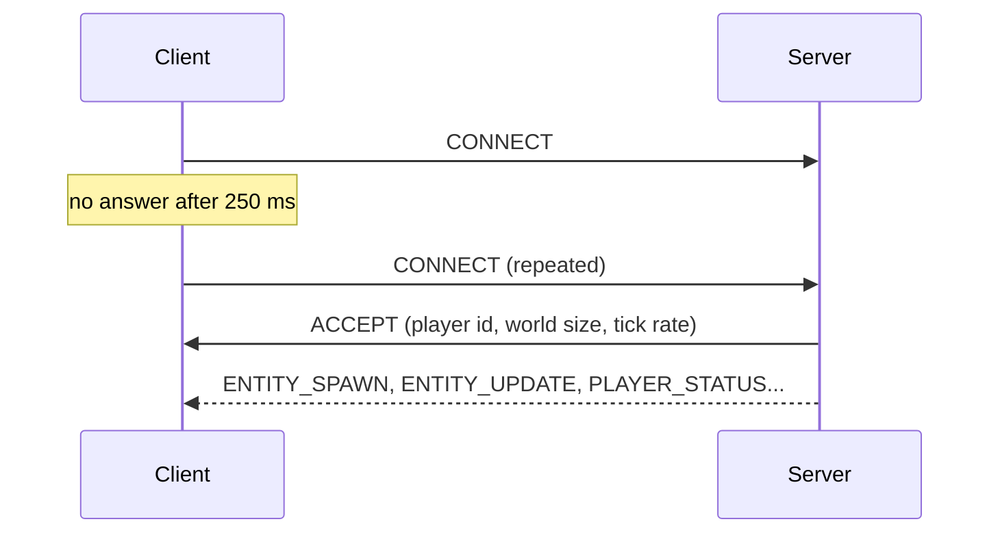
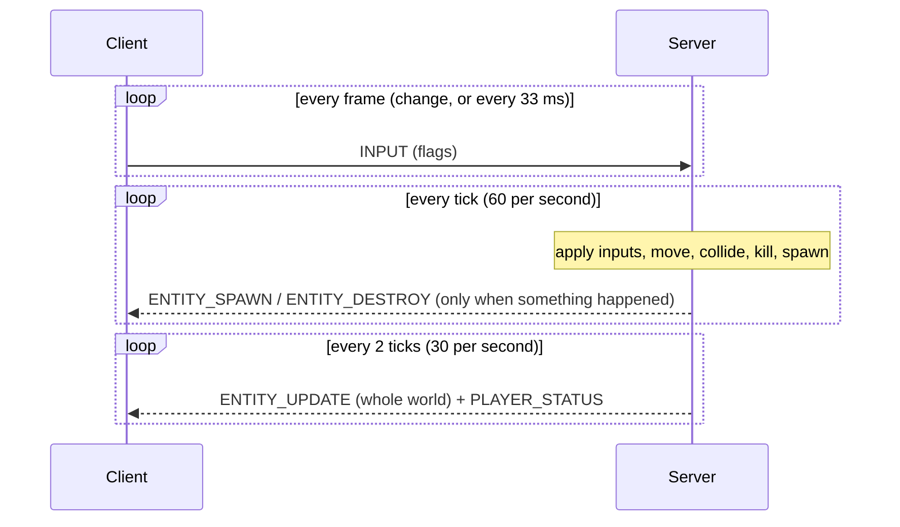
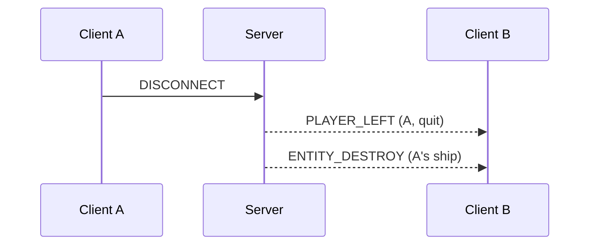

# R-Type Network Protocol — version 2

| | |
| --- | --- |
| Status | Version 2 extension of `contracts-v1` |
| Source of truth | `common/protocol/Packets.hpp`, `common/protocol/PacketCodec.cpp` |
| Author | danbmg |

This document specifies the protocol spoken between `r-type_server` and its clients. It is
complete enough to write a new client without reading the code.

The key words **MUST**, **MUST NOT**, **SHOULD** and **MAY** are to be read as in
[RFC 2119](https://www.rfc-editor.org/rfc/rfc2119).

## 1. Overview

- The server is the **authority**. Clients send their inputs; the server runs the game and
  reports what happens: entities that appear, move and disappear, player lives and scores.
  A client never decides a hit, a death, a spawn or a score.
- Every message travels over **UDP**. There is no TCP connection.
- The protocol is **binary**: fields have a fixed size and a fixed order, with no text and no
  separators.
- UDP can lose, duplicate and reorder datagrams. The protocol does not resend anything in
  version 2. It stays correct anyway because the server sends the **full state of the world**
  30 times per second: a lost datagram is corrected by the next one.

## 2. Transport

| Item | Value |
| --- | --- |
| Transport | UDP over IPv4 |
| Default server port | 4242 (`r-type_server -p <port>` changes it) |
| One datagram | exactly one packet: a header followed by its payload |
| Maximum datagram size | 1200 bytes (header included) |

1200 bytes fit in the smallest MTU guaranteed by IPv6 (1280 bytes) together with the IP and UDP
headers, so a datagram is never fragmented on its way.

A client uses one UDP socket for the whole session. The server identifies a client by the
**source address and port** of its datagrams.

## 3. Data types

All multi-byte values are in **network byte order (big-endian)**, whatever the byte order of
the machine.

| Type | Size | Encoding |
| --- | --- | --- |
| `u8` | 1 | unsigned integer |
| `u16` | 2 | unsigned integer, big-endian |
| `u32` | 4 | unsigned integer, big-endian |
| `f32` | 4 | IEEE 754 binary32, its 32 bits sent as a big-endian `u32`. MUST be finite (no NaN, no infinity) |

Fields are written one after the other with no padding. Implementations MUST serialize field by
field and MUST NOT copy a C/C++ structure to the wire: padding and layout differ between
compilers.

## 4. Header

Every packet starts with this 10-byte header.

| Offset | Size | Field | Value |
| --- | --- | --- | --- |
| 0 | `u16` | magic | `0x5254` (ASCII `"RT"`) |
| 2 | `u8` | version | `2` |
| 3 | `u8` | type | packet type, see section 5 |
| 4 | `u32` | sequence | incremented by the sender for every datagram it sends, starting at any value |
| 8 | `u16` | payload size | number of bytes after the header |

The first four bytes (magic, version, type) keep this layout in every future version, so a peer
can always recognise a packet from another version and answer it (section 7.6).

The server keeps a separate sequence counter for each client. Sequence numbers wrap around after
`2^32 - 1`; they are compared with serial number arithmetic (RFC 1982): `a` is newer than `b`
when `(int32)(a - b) > 0`.

## 5. Packet types

| Code | Name | Direction | Payload size |
| --- | --- | --- | --- |
| `0x01` | CONNECT | client → server | 0 |
| `0x02` | INPUT | client → server | 1 |
| `0x03` | PING | client → server | 4 |
| `0x04` | DISCONNECT | client → server | 0 |
| `0x08` | ACCEPT | server → client | 6 |
| `0x09` | REJECT | server → client | 1 |
| `0x0A` | PONG | server → client | 4 |
| `0x10` | ENTITY_SPAWN | server → client | 2 + 14 × count |
| `0x11` | ENTITY_UPDATE | server → client | 6 + 14 × count |
| `0x12` | ENTITY_DESTROY | server → client | 2 + 5 × count |
| `0x13` | PLAYER_STATUS | server → client | 1 + 10 × count |
| `0x14` | PLAYER_LEFT | server → client | 2 |

Any other code is invalid.

## 6. Payloads

### 6.1 CONNECT (`0x01`), client → server

Empty payload. Asks to join the game. The client repeats it every 250 ms until it receives
ACCEPT or REJECT, and gives up after 3 seconds.

### 6.2 INPUT (`0x02`), client → server

| Offset | Size | Field |
| --- | --- | --- |
| 0 | `u8` | flags |

| Bit | Mask | Meaning |
| --- | --- | --- |
| 0 | `0x01` | up |
| 1 | `0x02` | down |
| 2 | `0x04` | left |
| 3 | `0x08` | right |
| 4 | `0x10` | fire |
| 5–7 | | MUST be 0 |

INPUT carries the **state** of the controls, not key presses: "right and fire are held now".
The server applies the most recent INPUT on each tick until a newer one arrives, and ignores an
INPUT whose sequence number is older than the last one applied (UDP reordering). A client SHOULD
send INPUT when the state changes, and repeat it at least every 33 ms otherwise, so that a lost
datagram is replaced quickly.

### 6.3 PING (`0x03`), client → server

| Offset | Size | Field |
| --- | --- | --- |
| 0 | `u32` | token: any value, returned unchanged in PONG |

The reference client sends one PING per second, with the time it was sent (in milliseconds) as
the token, and computes the round-trip time when the PONG comes back. Any datagram from a client
proves it is alive; PING keeps an idle client alive (section 7.4).

### 6.4 DISCONNECT (`0x04`), client → server

Empty payload. The client leaves. The server removes its ship and sends PLAYER_LEFT with reason
`Quit` to the other clients. A client SHOULD send it when the player quits; one that cannot
(crash) is detected by the timeout of section 7.4.

### 6.5 ACCEPT (`0x08`), server → client

| Offset | Size | Field | Rule |
| --- | --- | --- | --- |
| 0 | `u8` | player id | 0 to 3 |
| 1 | `u16` | world width | > 0, in world units |
| 3 | `u16` | world height | > 0, in world units |
| 5 | `u8` | tick rate | > 0, server simulation steps per second |

The client is now in the game. Its ship is the PLAYER entity whose player id matches. If a client
repeats CONNECT after it was accepted (the first ACCEPT was lost), the server answers with the
same ACCEPT again.

### 6.6 REJECT (`0x09`), server → client

| Offset | Size | Field |
| --- | --- | --- |
| 0 | `u8` | reason: `1` server full (4 players already), `2` version mismatch |

### 6.7 PONG (`0x0A`), server → client

| Offset | Size | Field |
| --- | --- | --- |
| 0 | `u32` | token copied from the PING |

### 6.8 Entity state (14 bytes, used by ENTITY_SPAWN and ENTITY_UPDATE)

| Offset | Size | Field | Rule |
| --- | --- | --- | --- |
| 0 | `u32` | entity id | unique; the server never reuses an id |
| 4 | `u8` | kind | see section 8.1 |
| 5 | `u8` | player id | 0 to 3, or `0xFF` for none |
| 6 | `f32` | x | top-left corner, world units, finite |
| 10 | `f32` | y | top-left corner, world units, finite |

The player id is the owner of a PLAYER ship and the shooter of a PLAYER_MISSILE (so a client can
draw them in that player's colour). It is `0xFF` for Bydos, bosses, enemy missiles, and pickups.

### 6.9 ENTITY_SPAWN (`0x10`), server → client

| Offset | Size | Field |
| --- | --- | --- |
| 0 | `u16` | count, at most 84 |
| 2 | 14 × count | entity states |

Entities that appeared during the last tick: a Bydos arrived, someone fired, a player joined.
This is an event, sent once; use it to play a sound. The entity also appears in the next
snapshots.

### 6.10 ENTITY_UPDATE (`0x11`), server → client — the snapshot

| Offset | Size | Field |
| --- | --- | --- |
| 0 | `u32` | server tick of the snapshot |
| 4 | `u16` | count, at most 84 |
| 6 | 14 × count | entity states |

The position of **every** entity in the world, sent every 2 ticks (30 times per second at 60
ticks per second). A world with more than 84 entities is split over several ENTITY_UPDATE
datagrams with the same tick.

### 6.11 ENTITY_DESTROY (`0x12`), server → client

| Offset | Size | Field |
| --- | --- | --- |
| 0 | `u16` | count, at most 237 |
| 2 | 5 × count | removals |

Each removal:

| Offset | Size | Field |
| --- | --- | --- |
| 0 | `u32` | entity id |
| 4 | `u8` | reason: `1` killed (destroyed on screen: show an explosion), `2` left the screen |

### 6.12 PLAYER_STATUS (`0x13`), server → client

| Offset | Size | Field |
| --- | --- | --- |
| 0 | `u8` | count, at most 4 |
| 1 | 10 × count | player states |

Each player state:

| Offset | Size | Field |
| --- | --- | --- |
| 0 | `u8` | player id, 0 to 3 |
| 1 | `u8` | lives left; 0 means game over for this player |
| 2 | `u8` | health in the current life |
| 3 | `u32` | score |
| 7 | `u8` | weapon: 0 standard, 1 double, 2 spread, 3 heavy |
| 8 | `u16` | rapid-fire time remaining in milliseconds (0: inactive) |

Sent with every snapshot, for every connected player: this is what the HUD shows.

Version 2 extends each player state from 7 to 10 bytes and adds pickup entity kinds.
Both client and server must be rebuilt together; version 1 peers are rejected by the existing
version negotiation. Inputs are unchanged: holding FIRE uses the server's equipped weapon.
Pickups are collected through server-side overlap checks; clients cannot grant themselves items.

### 6.13 PLAYER_LEFT (`0x14`), server → client

| Offset | Size | Field |
| --- | --- | --- |
| 0 | `u8` | player id, 0 to 3 |
| 1 | `u8` | reason: `1` quit (DISCONNECT), `2` timed out (crashed or network lost) |

## 7. Exchanges

### 7.1 Joining

When 4 players are already in the game, the server answers REJECT (server full).

### 7.2 Playing

### 7.3 What a client does with world packets

- **ENTITY_UPDATE**: ignore it if its tick is older than the newest tick already applied (UDP
  reordering). Otherwise, create or move every entity it lists. An entity listed in a snapshot
  but never announced by ENTITY_SPAWN (lost datagram) MUST be created all the same.
- **ENTITY_SPAWN**: create the entities that do not exist yet; play the matching sound.
- **ENTITY_DESTROY**: remove the entities; show an explosion when the reason is `killed`.
- An entity missing from every snapshot for 500 ms SHOULD be removed: its ENTITY_DESTROY was lost.

### 7.4 Heartbeat and timeouts

| Rule | Value |
| --- | --- |
| A client sends at least one datagram per interval (INPUT or PING) | 1 s |
| The server drops a client it has not heard from for | 3 s |
| A client considers the server gone when nothing arrived for | 3 s |

When the server drops a silent client, it removes its ship and sends PLAYER_LEFT with reason
`TimedOut` to the other clients. The game goes on for them. This is how a crashed client is
detected: it cannot say goodbye, it just stops talking.

### 7.5 Leaving

DISCONNECT may be lost; the server then drops the client 3 seconds later with reason `TimedOut`.

### 7.6 Version mismatch

A server receiving a CONNECT whose version byte differs from its own answers REJECT with reason
`version mismatch`, in its own version. A client that receives a packet with an unexpected version
SHOULD stop and report that the server is incompatible.

## 8. Game data

### 8.1 Entity kinds

| Code | Kind | Size in world units (for drawing) |
| --- | --- | --- |
| 1 | PLAYER (a ship; player id = owner) | 33 × 17 |
| 2 | BYDOS (an enemy) | 32 × 24 |
| 3 | PLAYER_MISSILE (player id = shooter) | 8 × 4 |
| 4 | ENEMY_MISSILE | 8 × 4 |
| 5 | BOSS | min(96, world width / 4) × min(72, world height / 4) |
| 6 | EXTRA_LIFE pickup | 20 × 20 |
| 7 | HEAL pickup | 20 × 20 |
| 8 | RAPID_FIRE pickup | 20 × 20 |
| 9 | DOUBLE_SHOT pickup | 20 × 20 |
| 10 | SPREAD_SHOT pickup | 20 × 20 |
| 11 | HEAVY_SHOT pickup | 20 × 20 |

### 8.2 Coordinates

- The world is `world width × world height` units (800 × 600 in version 2), sent in ACCEPT.
- The origin is the top-left corner of the screen; x grows to the right, y grows **downwards**.
- A position is the top-left corner of the entity.
- Entities can be slightly outside the world: Bydos enter from the right edge and leave on the
  left. A client draws what it can and lets the rest be clipped.
- A client scales world units to its window: `pixel = world × window size / world size`.

## 9. Validation (receiving side)

Every datagram is treated as hostile. A receiver MUST check, in this order, before using any
value:

1. size: at least 10 bytes (header) and at most 1200 bytes;
2. magic is `0x5254`;
3. version is `2` (see 7.6);
4. type is one of section 5;
5. payload size equals the number of bytes actually received after the header;
6. for lists, the count is within its maximum and `count × entry size` equals the remaining
   bytes. Memory is reserved only after this check;
7. every value is in range: known enum codes, input bits 5–7 at zero, player ids 0–3 (or `0xFF`
   where allowed), finite floats, width, height and tick rate above zero.

A datagram that fails any check MUST be dropped silently (the server counts it). It MUST NOT
crash the receiver, make it allocate memory from an unchecked size, or make it read outside the
datagram. In addition, the server:

- drops packets of a server → client type sent to it;
- ignores everything but CONNECT from an address that has not joined;
- processes at most 8 packets per client per tick and drops the rest (flood protection);
- queues at most 4096 received packets between its network thread and its game loop; beyond
  that, new datagrams are dropped, so a flood cannot exhaust memory.

A client accepts datagrams from the server's address only.

## 10. Constants

| Name | Value |
| --- | --- |
| Magic | `0x5254` |
| Version | `2` |
| Default port | 4242 |
| Header size | 10 bytes |
| Maximum datagram size | 1200 bytes |
| Maximum players | 4 |
| Tick rate | 60 per second |
| Snapshot rate | 30 per second |
| Heartbeat interval | 1 s |
| Timeout | 3 s |
| Maximum entities per ENTITY_SPAWN / ENTITY_UPDATE | 84 |
| Maximum removals per ENTITY_DESTROY | 237 |

## 11. Examples

Bytes in hexadecimal; `|` separates the header from the payload.

| Packet | Bytes |
| --- | --- |
| CONNECT, sequence 0 | `52 54 02 01 00 00 00 00 00 00` |
| ACCEPT: player 0, 800 × 600, 60 ticks/s | `52 54 02 08 00 00 00 00 00 06 \| 00 03 20 02 58 3C` |
| INPUT: up + fire, sequence 7 | `52 54 02 02 00 00 00 07 00 01 \| 11` |
| PING: token 1500 | `52 54 02 03 00 00 00 08 00 04 \| 00 00 05 DC` |
| ENTITY_UPDATE: tick 120, ship 5 of player 0 at (60, 111.5) | `52 54 02 11 00 00 00 2A 00 14 \| 00 00 00 78 00 01 00 00 00 05 01 00 42 70 00 00 42 DF 00 00` |
| ENTITY_DESTROY: entity 17 killed | `52 54 02 12 00 00 00 2B 00 07 \| 00 01 00 00 00 11 01` |
| PLAYER_STATUS: player 0, 3 lives, 2 health, score 1500 | `52 54 02 13 00 00 00 2C 00 0B \| 01 00 03 02 00 00 05 DC 00 00 00` |
| PLAYER_LEFT: player 2 timed out | `52 54 02 14 00 00 00 2D 00 02 \| 02 02` |
| REJECT: server full | `52 54 02 09 00 00 00 00 00 01 \| 01` |

These bytes are produced by the reference encoder; `tests/network/PacketCodecTests.cpp` checks
the header layout byte for byte.

## 12. Security considerations

- **No authentication, no encryption.** Anyone who can reach the port can join, and a third party
  on the path can read or forge packets. This is acceptable for a LAN game prototype; see the
  comparative study for what a public deployment would need.
- **Address spoofing.** UDP source addresses can be forged. An attacker who knows a player's
  address and port could send INPUT or DISCONNECT in their name. A forged CONNECT also makes the
  server send the game state to the forged address until the 3-second timeout: a small
  amplification, bounded by the 4 player slots. A session token returned in ACCEPT and required
  in every later packet would close both holes (a future version).
- **Resource exhaustion.** Sizes are bounded (1200-byte datagrams, 4096 queued packets, 8 packets
  per client per tick, 4 sessions), and every count is checked against the received length
  before any allocation.

## 13. Planned for a future version

Acknowledgements and resending for critical events, quantized coordinates and delta snapshots to
save bandwidth, client-side prediction, and several game rooms per server. They will come with a
new version number.
