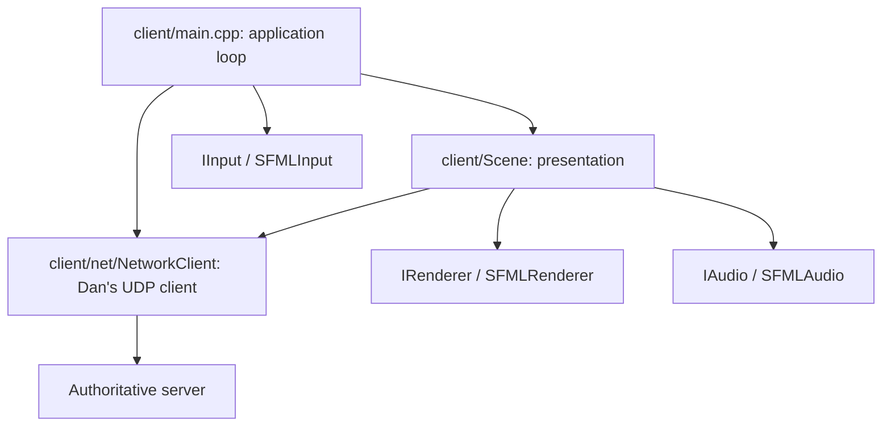

# Part 1 graphical client

The client displays the world received from the authoritative UDP server. It sends keyboard
inputs, never collision results, damage, scores or entity positions.

## Build and play

Use the dependencies described in the root README. From the repository root:

```sh
cmake -S . -B build -DCMAKE_BUILD_TYPE=Release
cmake --build build --parallel 4
ctest --test-dir build --output-on-failure
```

Start these commands in separate terminals:

```sh
./r-type_server -p 4242
./r-type_client -h 127.0.0.1 -p 4242
```

Press Enter in the client to connect. Launch up to four clients, using the server machine's
address when playing on a LAN. A fifth client displays the server's refusal. Each client controls
its own ship; keyboard input is sent only while that window has focus.

On Windows use `cmake --build build --config Release` and
`ctest --test-dir build -C Release --output-on-failure`, then the `.exe` executables.
Windows runtime validation must be performed on Windows; a Linux test is not a cross-play test.

Keep `assets/` beside the client executable when distributing it. An explicit path also works:

```sh
./r-type_client --assets /path/to/assets --mute
```

`--help` prints usage without opening a window. Invalid ports or missing assets produce an
error and exit code 84.

## Controls and accessibility

| Key | Action |
| --- | --- |
| Enter | Connect, retry, or rejoin after game over |
| Arrow keys | Move (default layout) |
| Space (hold) | Shoot; the server applies the cooldown |
| Tab | Cycle arrows, WASD and ZQSD |
| Escape | Disconnect and return to the start screen; press again to quit |
| M | Mute/unmute |
| + / - | Adjust effects volume by 10% |
| F1 | Enlarge the HUD |

The window can be resized; letterboxing preserves the aspect ratio. Players have both a
coloured bar and a P1–P4 label, so identifying them does not require colour discrimination.
Shots and destruction have visual effects as well as sounds. Connection and timeout errors are
written on screen. The start screen displays controls with no timed interaction.

The three keyboard presets provide a small motor-accessibility feature. Arbitrary key rebinding,
gamepad input, persistent settings, music and a graphical host/port editor are not implemented.
The server address is configured on the command line. These are explicit limits of this small
prototype, not features to claim at the defense.

## Structure



- `main.cpp`: reads options, constructs the implementations, handles connection and controls,
  and calls the other modules in one loop.
- `Scene`: maps `EntityKind` and `playerId` to sprites, draws the HUD, advances background stars,
  and translates network events into short visual/audio effects.
- `engine/render`: owns the window, font and texture cache. It receives positions, source
  rectangles and colours; it knows nothing about players, health or collisions.
- `engine/input`: translates SFML keyboard state into generic keys and detects press edges.
- `engine/audio`: owns sound buffers and at most 16 simultaneous effects. Buffers outlive sounds.
- `Options`: validates the command line without opening a window.

The existing server, protocol and network modules were copied unchanged from
`origin/feat/danbmg/network` at commit `14324fd` for this integration. Their authorship remains
Dan's. The root build already discovers these module directories, so no root CMake change was
necessary. Shared packet and ECS component contracts were not changed.

## One frame, explained

1. Measure elapsed time with the engine's monotonic clock.
2. Poll window events and keyboard state. On focus loss, all gameplay keys become false.
3. Call `NetworkClient::update()` to apply queued server messages.
4. Send directional/fire booleans while connected.
5. Consume events: missile spawn plays a shot; destruction plays an explosion; player timeout
   displays a notification.
6. Advance stars and animation timers using elapsed seconds.
7. Draw the background, received entities, effects and HUD, then display the frame.

The server reports top-left coordinates in its world dimensions. The scene scales them to an
800×600 playfield, below a 56-unit HUD. A separate 24-unit footer shows controls.
The renderer scales the complete 800×680 canvas to the physical window.

Scrolling uses `distance = speed * elapsedSeconds`. Enemy animation selects a frame from
elapsed time, not a frame counter. Rendering is capped at 60 FPS to avoid wasting CPU.
Visual delta time is capped at 0.1 seconds after a stall; this deliberately pauses part of the
cosmetic animation during long stalls and never affects the server simulation.

There is no client prediction or interpolation in this version: entities use the last received
server position. The server continues to own all movement, shooting and combat rules.

## Adding an appearance or effect

Place an asset in `assets/`, load it once in `Scene::load`, and select a source rectangle in
`Scene::drawGame`. Sprite rectangles and colours belong in the client, not the generic renderer
or protocol. For a new sound, load its buffer once and trigger it from a received event.
Do not load resources in the frame loop or trigger one-shot sounds every time an entity is drawn.

## Validation and defense

The client tests reject malformed ports and compare star positions after one simulated second
at 30 and 144 FPS. These tests use an `IRenderer` fake and do not need a display/audio device.
The existing network tests cover packet validation and server/client integration.

For the manual demo:

1. Connect four graphical clients and identify their P1–P4 labels.
2. Move and shoot in one window; observe the same ship and missile in another.
3. Observe random Bydos, hostile shots, collisions, HP/lives and score.
4. Resize a window, switch keyboard layout, enlarge text and mute sounds.
5. Kill one client abruptly; after the timeout, others display its departure and keep playing.
6. Stop the server; clients display connection loss and offer retry.

Read `main.cpp`, `Scene.cpp`, then the three engine implementations for the shortest code tour.
Explain the data flow and ownership before discussing SFML calls.
See also the [graphics/audio study](client-study.md) and [asset provenance](https://github.com/EpitechPGE3-2026/G-ING-500-NCE-5-1-rtype-2/blob/main/assets/README.md).

### Local validation recorded on 2026-10-20

- Linux Release build with `RTYPE_WARNINGS_AS_ERRORS=ON`: passed.
- CTest: 76 tests passed, including the client timing/argument tests and existing network tests.
- Four real SFML client processes connected to one server on an isolated X display.
- Synthetic keyboard input moved player 1 by approximately 117 world units according to
  received server updates; a player-owned missile was also received.
- HUD enlargement, keyboard preset change, mute and window resizing were exercised and
  screenshots inspected.
- Killing the fourth client generated a timeout notification; stopping the server left the
  other clients alive on the connection-error screen.
- Audio resources and playback were exercised with a null audio device. Actual speaker output
  and Windows/cross-play still need a manual check on the target machines.
